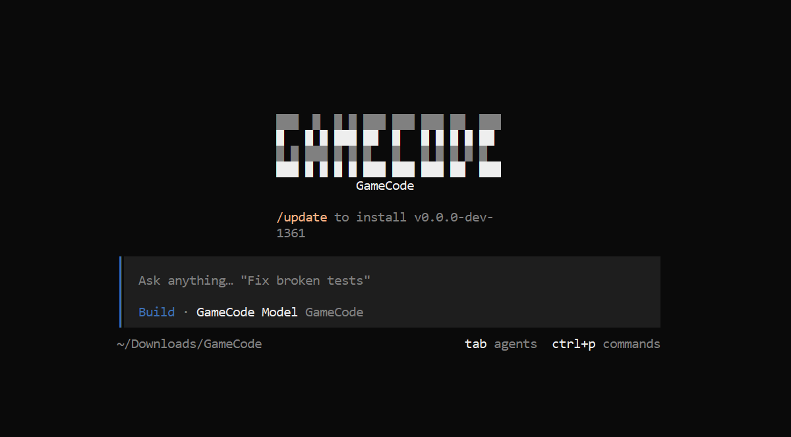

# GameCode

### A focused AI coding assistant for C++ and C# development

GameCode is a customized version of the open-source [OpenCode](https://github.com/anomalyco/opencode) project. It brings a branded terminal interface, role-based coding agents, project-aware tools, and a Windows installer together in one development workflow.

**Created by Uzair Moazzam**



## Get GameCode for Windows

**[Download the GameCode Windows installer](https://github.com/Uzairrr21/GameCode/releases/latest/download/GameCode-win-x64.exe)**

### Install and start

1. Download and run the installer.
2. Enter an OpenCode Console/Zen API key during setup to enable the five custom agents. Leave it blank to use the built-in **Build** and **Plan** agents.
3. Open **GameCode** from the Start Menu or desktop shortcut.
4. Choose the folder containing the project you want to work on.
5. Press **Tab** to switch between available agents.

GameCode opens your selected project in its terminal interface. VS Code and manual Python or pip installation are not required. An internet connection is needed while installing dependencies and when using AI models.

## Agents

GameCode includes the built-in **Build** and **Plan** agents and five custom primary agents. Each custom agent has its own role, assigned model, system prompt, and focused subagent.

| Agent | Focus |
|---|---|
| Build | General coding and implementation |
| Plan | Read-only analysis and planning |
| Agent1 | Coding orchestration, implementation, and verification |
| Agent2 | Requirements, planning, and implementation |
| Agent3 | Architecture and integration |
| Agent4 | Code analysis and refactoring |
| Agent5 | Focused implementation and routine development |

Switching agents keeps the active project and session context available. Agents can also create Markdown hand-offs to pass useful work summaries between roles.

## Project capabilities

| Part | Implementation |
|---|---|
| **1. Branding** | GameCode name and visual identity in the terminal dashboard and user-facing experience. |
| **2. Primary agents and subagents** | Build and Plan plus Agent1–Agent5; each custom primary has an assigned model and at least one subagent. |
| **3. Model anonymization** | Model and provider names are hidden in the interface while Zen and OpenRouter routing remains available. |
| **4. System prompts** | Role-specific prompts for primary agents and subagents. |
| **5. Prompt protection** | Prompts are stored encrypted and loaded on demand for the active agent. |
| **6. Context and hand-off** | Session context persists across agent switches; Markdown hand-offs and outputs are supported. |
| **7. Guardrails** | Prompt-injection and off-topic protections, C++/C# focus, restricted Plan permissions, and next-step guidance. |
| **8. Tools and skills** | MCP integrations, shell access, and a credited C++ skill informed by the MIT-licensed [awesome-copilot](https://github.com/github/awesome-copilot) project. |
| **9. Model selection lock** | Model and variant selection and custom-agent mentions are disabled; Tab switches agents. |
| **10. API-key gating** | The installer collects an OpenCode Console/Zen key and gates access to custom agents. |
| **11. License expiry** | A 48-hour license window controls protected agent and tool access. |
| **12. Installer and uninstaller** | Windows `.exe` setup installs app-local Python, pip, and Graphifyy; the uninstaller removes the application and its bundled runtime. |

## How it works

```text
Choose a project folder
        |
        v
Select an agent with Tab
        |
        v
Work with the project using its assigned role, prompts, and tools
        |
        v
Continue with the same session context or a Markdown hand-off
```

Agent model assignments are managed by GameCode, so users can focus on the task and agent role instead of provider-specific model names. The Plan agent is restricted from editing project files and running build commands.

## Credits

GameCode is a modified version of [OpenCode](https://github.com/anomalyco/opencode) and retains the project license in [LICENSE](LICENSE). The C++ skill is informed by the MIT-licensed [GitHub Copilot awesome-copilot](https://github.com/github/awesome-copilot) project.
